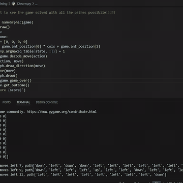
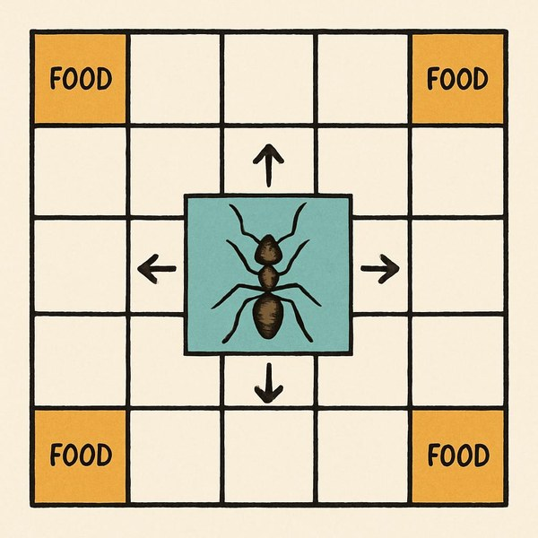
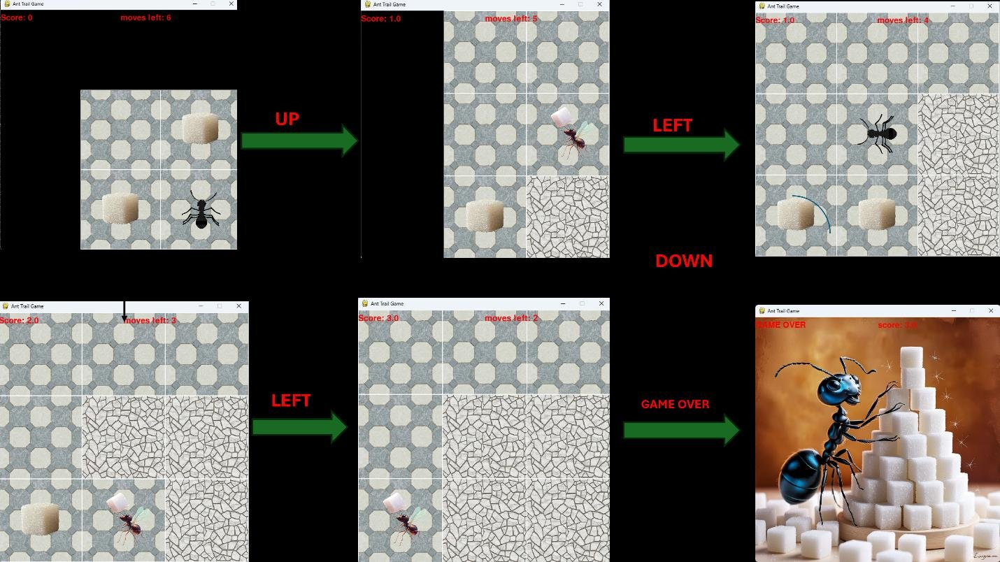

# 🐜 Ant Trail Problem — Solving a Grid Game with AI

An ant is dropped on a grid with sugar hidden around it. It can only see the cells close to it, it has a limited number of moves, and walking off the board ends the game. **How should it move to collect as much sugar as possible?**

This project builds the game from scratch in Python and compares several AI approaches to solving it: **search** (Monte Carlo Tree Search), **reinforcement learning** (Q-Learning and Deep Q-Learning), **evolutionary algorithms** (genetic algorithm and genetic programming) and **supervised learning** (neural network and decision tree trained on expert moves).

<p align="center">
  
  <br><em>Q-Learning agent playing on a 10×10 grid</em>
</p>

📄 **Full project report:** [docs/356943_Kedis_Bassem.pdf](docs/356943_Kedis_Bassem.pdf)

---

## ✨ Highlights

- Designed and built the **game environment from scratch** (game logic, graphics, sound) in Python with pygame
- Implemented and compared **6 AI approaches** on the same problem: search, reinforcement learning, evolutionary algorithms and supervised learning
- **MCTS scored a perfect result in 10/10 games** on the 3×3 grid and outperformed the learned agents in every setting where they were compared
- Built a full **data pipeline**: expert solver → labelled dataset (CSV / Weka ARFF) → trained models → evaluation charts

---

## 🎮 The Game

| Rule | Detail |
|---|---|
| Grid | `N × N` cells, with `N` sugar cells placed at random |
| Start | The ant starts on a random empty cell |
| Moves | Up, down, left, right — `2N` moves in total |
| Vision | The ant only sees a `(2m+1) × (2m+1)` window around itself (`m` = view radius); the rest of the grid stays hidden until explored |
| Reward | **+1** for each sugar collected |
| Penalty | Going back to an already-visited cell costs points; stepping **off the grid** gives **−(N+2)** and ends the game |
| End | All sugar collected, no moves left, or ant off the grid |

Because the ant only sees part of the grid, this is a **partially observable** problem: the agent has to balance collecting the sugar it can see with exploring to discover new cells.

<p align="center">
  
  <br><em>The ant, its field of view and its 4 possible moves</em>
</p>

<p align="center">
  
  <br><em>A full game on a 3×3 grid: hidden cells (black) are revealed as the ant explores, visited cells are marked as cracked, and the ant collects all 3 sugar cubes in 4 moves</em>
</p>

A playable version (keyboard controls W/A/S/D, with graphics and sound) is included in `src/Normal Game/`.

---

## 🧠 Methods

### 1. Optimal solver (backtracking) — the "expert"
With full knowledge of the grid, a **backtracking search** explores the move sequences (trying high-reward cells first) and returns the best path (highest score, then most moves left). It is used as a reference and to **generate labelled training data** for the supervised models.

This works well up to `N = 6`. Beyond that the search space explodes — a 10×10 grid has 20 moves, so up to 4²⁰ ≈ 10¹² possible paths — so **MCTS is used to generate data for larger grids**.

### 2. Monte Carlo Tree Search (MCTS)
The agent plans each move by building a search tree in real time (0.1 s per move):
- **Selection** with the UCB1 formula (exploration constant √2)
- **Expansion** over the legal moves
- **Rollouts** with an ε-greedy heuristic policy (ε = 0.1) that prefers moves with immediate reward and moves that reveal new cells
- **Backpropagation** of the outcome `score + 0.1 × moves_left`, so faster solutions are preferred

MCTS was the most reliable approach and is also used to create datasets for the learning agents.

### 3. Q-Learning (tabular)
Classic reinforcement learning on a fixed grid: the state is the ant's position and a Q-table stores the value of each of the 4 moves.
- 10,000 episodes, learning rate 0.01, discount factor 0.9
- ε-greedy exploration decaying from 1.0 to 0.1
- Bonus reward for finishing with a high score and moves left

The demo above shows the learned policy on a 10×10 grid.

### 4. Deep Q-Learning (experimental)
A neural network replaces the Q-table so the agent can generalise across grids.
- MLP with one hidden layer (128 units), PyTorch
- Experience replay (memory 100,000, batch 1,000), Adam optimiser, MSE loss
- State encoded as one-hot maps of danger, food and ant position

<p align="center">
  
  <br><em>Training progress (left) and exploration rate ε decay (right)</em>
</p>

### 5. Supervised learning from expert moves (imitation learning)
Games solved by the expert (backtracking or MCTS) are recorded as pairs of **ant view → best move**, and models are trained to copy those decisions:
- **Neural network** (PyTorch): small MLP, cross-entropy loss, Adam
- **Decision tree** (scikit-learn, entropy criterion)
- **Genetic programming** (gplearn symbolic regression): evolves a formula whose output is mapped to one of the 4 directions
- Data is also exported to **ARFF** format for analysis in **Weka**

> **Observation:** most games have **several equally optimal paths**, so the same situation can be labelled with different "correct" moves. This makes the dataset noisy and explains part of the gap between the supervised models and MCTS. Collecting more diverse games, or adding rotated/mirrored versions of each state, are natural ways to improve them.

### 6. Genetic Algorithm
Evolves a full sequence of moves for a given grid:
- Each genome is a list of `2N` moves (2-bit encoding)
- Tournament selection (size 5), single-point crossover (rate 0.7), mutation (rate 0.01)
- Population 100, 100 generations
- Fitness = score + moves left

Best score reached within 100 generations: 3/3 on 3×3, 4–5/5 on 5×5 and 5–6/10 on 10×10. Unlike the other agents, it optimises a plan for **one fixed grid** rather than reacting to what the ant sees.

---

## 📊 Results

Average score over **10 test games** (maximum possible score = `N`, the number of sugar cells). Supervised models were trained on data from 10 expert-solved games.

| Grid | View radius | Decision Tree | Neural Network | **MCTS** |
|:---:|:---:|:---:|:---:|:---:|
| 3×3 | m = 1 | 1.7 / 3 | 1.7 / 3 | **3.0 / 3** (10/10 perfect) |
| 3×3 | m = 2 | 2.8 / 3 | 2.3 / 3 | — |
| 5×5 | m = 2 | 2.2 / 5 | 1.3 / 5 | **3.4 / 5** |
| 10×10 | m = 1 | — | — | **5.4 / 10** |
| 10×10 | m = 2 | — | — | **4.1 / 10** |

**Key takeaways**
- **MCTS is the strongest and most consistent agent.** It never walked off the grid in the test games and solved every 3×3 game perfectly.
- A **wider field of view helps** the supervised models (Decision Tree 1.7 → 2.8 on 3×3), since they see more of the board before choosing.
- The supervised agents sometimes **walk off the grid** (negative scores), because they copy single moves without planning ahead — something MCTS handles by simulating the future.

---

## 📁 Project Structure

```
├── src/
│   ├── Normal Game/               # Playable game with graphics and sound (pygame)
│   ├── game in slide/             # Game version shown in the presentation
│   ├── monte carlo/               # MCTS agent + generated datasets
│   ├── neural network training/   # Q-Learning and Deep Q-Learning experiments
│   └── final/
│       ├── main.py                # Trains and evaluates the learning agents
│       ├── gamelogicF.py          # Game logic + optimal backtracking solver
│       ├── agentN.py              # Neural network agent (PyTorch)
│       ├── agentT.py              # Decision tree agent (scikit-learn)
│       ├── agentG.py              # Genetic programming agent (gplearn)
│       ├── genetic.py             # Genetic algorithm
│       ├── collectdata.py         # Generates training data from the expert solver
│       ├── wekadata.py            # Exports data to ARFF for Weka
│       └── data/                  # Datasets
├── images/  audio/                # Game assets
└── docs/                          # Project report and demo
```

---

## 🚀 Getting Started

**Requirements:** Python 3.10+

```bash
git clone https://github.com/bassemr/Ant-Trail-Problem-.git
cd Ant-Trail-Problem-
pip install numpy pandas matplotlib pygame torch scikit-learn gplearn joblib sortedcontainers ipython
```

**Play the game yourself**
```bash
cd "src/Normal Game"
python humangameedit.py
```
> If images or sounds don't load, update `PATH_IMAGES` and `PATH_AUDIO` at the top of `humangameedit.py` (and `src/game in slide/antgame.py`).

**Watch MCTS play**
```bash
cd "src/monte carlo"
python mcts.py
```

**Train Q-Learning and watch the learned policy**
```bash
cd "src/neural network training"
python Qlearn.py
```

**Train and compare the supervised agents / run the genetic algorithm**
```bash
cd src/final
python collectdata.py   # create a dataset with the expert solver
python main.py          # train + evaluate (choose the agent in main())
python genetic.py
```

---

## 🛠️ Tech Stack


---

## 👤 Author

**Bassem Kedis** — Computer Engineer, MSc in Artificial Intelligence (University of Parma)
[LinkedIn](https://www.linkedin.com/in/bassem-kedis-845649336/) · [GitHub](https://github.com/bassemr)
